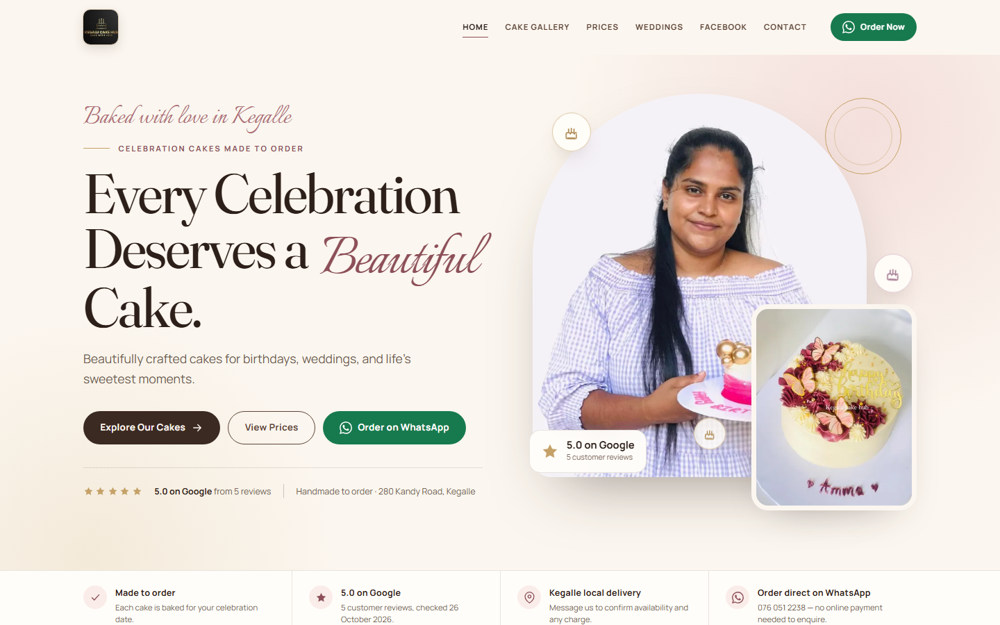

# Kegalu Cake Hub

<p align="center">
  
</p>

<p align="center">
  <a href="https://kegalucakehub.pages.dev"></a>
  
  
  
  
  
</p>

A production website for **Kegalu Cake Hub**, a celebration cake bakery at 280 Kandy Road, Kegalle, Sri Lanka. Customers browse the gallery, configure a cake size and flavour with live pricing, and send an order enquiry directly through WhatsApp.

**Live:** <https://kegalucakehub.pages.dev>

The site is built from small HTML templates at build time. There is no framework, database, admin panel or frontend API key. All content the owner normally changes lives in one file: `assets/js/config.js`.

## Highlights

- Seven-page static site with shared header/footer partials and per-page SEO metadata.
- Interactive price configurator: 500 g / 1 kg, vanilla / chocolate, independent prices, live WhatsApp message.
- Filterable gallery with deep links, accessible lightbox and empty states.
- Wedding quote form with validation and prefilled enquiry categories.
- Strict CSP and security headers, responsive WebP images generated with Sharp, sitemap and robots.txt.
- Unit tests for the pure pricing and WhatsApp message logic (`npm test`).

## Quick start

```bash
npm install       # first time only (installs Sharp for image processing)
npm run build     # writes the production site to _site/
npm test          # runs the price/WhatsApp logic tests
npm run dev       # builds, then serves http://localhost:4173
```

`npm run serve` serves an existing build without rebuilding. The preview server mirrors the production security headers from `netlify.toml` / `_headers` (without `upgrade-insecure-requests`, so local HTTP keeps working).

## Pages

| File | Purpose |
| --- | --- |
| `src/index.html` | Home: hero, trust strip, featured designs, 8 categories, custom cake section, Reels strip, Google rating, final CTA |
| `src/gallery.html` | Full gallery with 8 category filters, empty state and accessible lightbox |
| `src/prices.html` | Interactive 500g/1kg + Vanilla/Chocolate price configurator and price table |
| `src/weddings.html` | Wedding cakes, cupcakes, mini cakes, slab cakes and quote enquiry form |
| `src/social.html` | Manual Facebook Reels and post embeds with visible fallback links |
| `src/contact.html` | Contact details, map, ordering steps, general contact form |
| `src/404.html` | Not-found page (noindex) |

`src/partials/header.html` and `src/partials/footer.html` are shared by every page. `scripts/build.js` injects partials, per-page SEO tokens, active navigation state and structured data.

## Deploying to Cloudflare Pages

The live site is at **https://kegalucakehub.pages.dev** (project `kegalucakehub`). `_headers` and `_redirects` are copied into `_site` at build time, so security headers, CSP, cache rules and the `/index.html` → `/` redirect apply on Cloudflare Pages. `404.html` is served automatically.

**Option A — direct upload (current setup)**

```bash
npm run build
npx wrangler@latest pages deploy _site --project-name=kegalucakehub --branch=main
```

Wrangler must be logged in to the owner's Cloudflare account (`npx wrangler login`).

**Option B — Git continuous deployment**

1. Create a Pages project connected to this repository.
2. Framework preset: **None**.
3. Build command: `npm run build`.
4. Build output directory: `_site`.
5. Every push to the production branch deploys.

To attach a custom domain later, add it in the Pages project (Custom domains), follow the DNS instructions, then change `site.url` in `assets/js/config.js` to the custom domain and redeploy so canonical URLs, Open Graph tags, the sitemap and structured data all match.

## Deploying to Netlify

`netlify.toml` is already configured:

- Build command: `npm run build`
- Publish directory: `_site`
- Node version: 22
- Security headers, CSP, cache headers and the `/index.html` → `/` redirect

**Option A — Git continuous deployment (recommended)**

1. Push this project to the repository connected to the Netlify site.
2. Netlify reads `netlify.toml`; no dashboard build settings are needed.
3. Every push builds and deploys.

**Option B — manual deploy**

```bash
npm run build
npx netlify-cli deploy --prod --dir=_site
```

You can also drag the generated `_site` folder onto the Netlify **Deploys** page.

> Cloudflare Pages is the primary host. The Netlify config is kept so the site can still build there, but a Netlify deploy would publish the same `pages.dev` canonical URLs. A Netlify deploy replaces the live `kegalucakehub.netlify.app` site, so get the owner's approval first.

## Updating content

Everything below is edited in `assets/js/config.js`, then `npm run build` (Netlify does this automatically on deploy).

### 1. Standard cake prices

```js
export const cakePrices = {
  prices: {
    '500g': { vanilla: 2500, chocolate: 2800 },
    '1kg':  { vanilla: 4800, chocolate: 5200 },
  },
};
```

- Numbers only, no `Rs.` and no commas.
- Each of the four combinations is independent. The site **never** calculates a 1kg price from 500g.
- A `null` value displays **“Price to be confirmed”** everywhere, and the WhatsApp message says the same. Do not guess a price.
- `cakePrices.note` is the sentence shown under a confirmed price.
- `cakePrices.provisional['500g'].range` is the only provisional range currently published (`Rs. 500 – 3,800`). Remove it if the owner does not want it shown. `1kg` provisional range is intentionally blank until confirmed.
- The price table and order message update automatically at build time.

### 2. Wedding and celebration quotes

`weddingPricing.categories` holds the four wedding cards. Edit `guide` to a price or `"Quote required"`. The strings are guidance, not binding quotes. `formCategory` must match one of the values in `enquiryCategories` so the enquiry form prefill works.

### 3. Gallery designs and photos

1. Put the original photo in `assets/img/legacy/` (or another folder you reference).
2. Add a name/path entry to the `sources` object in `scripts/optimize-images.cjs`.
3. Run `npm run images` to generate responsive WebP sizes in `assets/img/opt/` and update `scripts/image-manifest.json`.
4. Add an object to `cakeGallery` in `assets/js/config.js`:

```js
{
  id: 'unique-kebab-id',
  title: 'Cake name',
  categories: ['birthday', 'custom'],   // ids from galleryCategories
  image: 'imageKey',                    // key from optimize-images.cjs
  alt: 'Describe the cake for screen readers',
  description: 'One short sentence shown in the gallery and lightbox.',
  featured: true,                       // appears on the home featured grid
}
```

- Every card uses the real photo, optimized sizes, lazy loading below the fold and `srcset`.
- If a design has a **public** Facebook post URL, add `facebook: 'https://...'` to that object; the lightbox will show “View original post”.
- Category cards on the home page use the optional `image` field on `galleryCategories`.
- Keep `id` stable: gallery deep links use `#cake-<id>`.

### 4. Facebook Reels and posts

```js
export const facebook = {
  reels: [{ id, url, title, description, cover }],
  posts: [{ id, url, title, text }],
};
```

- Use **numeric public permalinks**, for example:
  - `https://www.facebook.com/100087444283691/posts/1023064447285022/`
  - `https://www.facebook.com/100087444283691/videos/1670922514694113/`
- Slug-style URLs (the long text before the number) can fail inside Facebook's embed plugin. The current posts use numeric URLs because those load reliably.
- This is a **manual** list. The site does not scrape, sync, or copy private Facebook content, and it does not pretend to update automatically.
- Every embed has a plain “Open this post/Reel on Facebook” fallback beneath it. If an embed is unavailable, the page still works.
- Facebook may block embeds for some logged-out, regional or privacy settings. Re-check after changing a link.
- Reel `cover` values must exist in `scripts/image-manifest.json` (`reelDelivery`, `reelCutting` currently).

### 5. Google reviews

```js
export const reviews = {
  google: {
    rating: 5.0,
    count: 5,
    url: site.googleListing,
    checked: '2026-10-26',
    items: [],
  },
  showPreviousWebsiteTestimonials: false,
};
```

- **Do not invent reviews, names, ratings or counts.**
- `items` should only be filled with review text the owner has verified and is allowed to republish. Each item needs `{ name, rating, date, text }`. The home page then renders real quote cards.
- While `items` is empty, only the verified Google aggregate (5.0 from 5) and a link to the listing are shown. This is intentional.
- `showPreviousWebsiteTestimonials` is **false**. Three quotes from the old website are stored below it but hidden. Turn it on only after the owner confirms each quote is genuine and consents to publication.
- An official live Google reviews feed would need a Google Places API key and a server-side proxy; no key is included and no key belongs in frontend code.

### 6. Contact, WhatsApp and social links

`site` contains the address, map links, WhatsApp number, phone number, Facebook page and Google listing. Keep the WhatsApp number in international format without `+` or spaces (`94760512238`). All order/enquiry URLs are generated from it and URL-encoded.

### 7. Page titles, descriptions and social previews

These live at the top of each file in `src/` as `title`, `description`, `og:*` and canonical tokens. The canonical host is currently `https://kegalucakehub.pages.dev`. If a custom domain is connected, update `site.url` and the canonical/OG values plus the sitemap and robots generators in `scripts/build.js`.

## What is deliberately not published

These were not verifiable and must not be invented:

- Delivery charges or guaranteed delivery areas (the site says to confirm by WhatsApp).
- Opening hours.
- Payment methods.
- Final standard cake prices.
- Final wedding/custom quotes.
- Review wording beyond the Google aggregate.

## Owner confirmations and assets still needed

1. **Four final standard prices** — 500g Vanilla, 500g Chocolate, 1kg Vanilla, 1kg Chocolate.
2. **Address** — confirm `280 Kandy Road, Kegalle 71000` and the map pin.
3. **Review permission** — confirm whether the three old-website quotes are genuine and may be republished. Ideally add current Google review text via the owner's Business Profile.
4. **Facebook links** — confirm the featured posts/Reels still represent the business and are public; refresh periodically.
5. **Photo rights** — owner permission for every cake/customer photo used.
6. **Delivery, hours and payment** — provide only if the business wants them published.
7. **Custom domain and email** — optional; update `site.url` if added.
8. **Hosting access** — Cloudflare account access is required for Pages deploys; the site is already deployed there. Netlify credentials are only needed if the Netlify copy is kept in sync.
9. **Google Places API** — optional, only for automatic review syncing; requires a paid/qualified Google Cloud setup and a server-side key.

## Testing status

Passing locally:

- `npm test`: 7/7 unit tests for pricing lookup, “Price to be confirmed”, independent 1kg pricing, numeric strings, URL encoding and design fallback.
- All 8 gallery filters and counts; empty state; lightbox open/next/previous/close/Escape; `#cake-…` deep links.
- All four weight/flavour combinations show **Price to be confirmed**, and WhatsApp messages contain no fabricated price. A temporary configured-price build was used to verify each of the four values updates independently, then the config was restored to `null`.
- Wedding enquiry validation (required fields, past date, short contact, invalid reference), category prefill, formatted WhatsApp message and “nothing is sent until you press send” status.
- Contact form validation and WhatsApp message; Google map embed.
- Facebook Reels and posts load, with fallback links; all three posts were replaced with verified numeric URLs after stale embeds were found.
- CSP and security headers verified on the local preview and on the live Cloudflare Pages site; Facebook and Google Maps frames still load; no page console errors (Facebook's own embed logs an internal non-fatal error).
- Lighthouse (desktop and mobile snapshots) on every page: 100 Accessibility, 100 Best Practices, 100 SEO.
- Desktop 1440px, tablet 620px and 760px, mobile 390px; mobile menu, mobile order bar, no horizontal overflow, forms stack correctly.
- Final crawl of the built site: every internal link and image resolves; no unreplaced `{{TOKENS}}`, no `href="#"`, no inline scripts or styles.
- Live Cloudflare Pages: all pages return 200 on clean URLs, legacy `.html` URLs return 301, unknown paths return the custom 404, and CSP/cache headers are present.

Not tested here:

- The Netlify deployment and its response headers (deployment was not authorised there).
- Safari/iOS and real-device WhatsApp handoff.
- Facebook embeds for every logged-out/region/privacy combination.
- Live Google Places API review sync (not included).

## Project structure

```
assets/
  css/main.css              design system and all page styles
  js/config.js              single content file (prices, gallery, social, reviews)
  js/main.js                sticky header, mobile menu, reveal animations
  js/pricing-core.js        pure price/WhatsApp logic (tested)
  js/pricing.js             price configurator UI
  js/gallery.js             filters, empty state, lightbox, deep links
  js/forms.js               enquiry/contact validation and WhatsApp messages
  js/boot.js                adds the `js` class (keeps CSP strict)
  img/legacy, img/google, img/fb   original photos and Reel covers
  img/opt/                  generated responsive WebP files
  fonts/                    self-hosted Fraunces, Manrope, Italianno
src/                        HTML templates and partials
scripts/
  build.js                  template/build orchestration
  render.js                 card, filter, review, social and price renderers
  optimize-images.cjs       Sharp responsive image pipeline
  make-icons.cjs            app icons
  serve.js                  local preview with production-like headers
  pricing.test.js           unit tests
_site/                      generated output (published to Cloudflare Pages)
netlify.toml                Netlify build settings
_headers, _redirects        Cloudflare Pages headers and legacy URL redirects
site.webmanifest            static root file copied into _site
_site/sitemap.xml           generated at build time
_site/robots.txt            generated from site.url at build time
```
